# YarnBreak — Real-time Yarn-Break Detection on NVIDIA Jetson

[](https://github.com/nhphuc5208/Yarnbreak_JS/actions/workflows/ci.yml)

[](LICENSE)

> **Tóm tắt (VI):** Hệ thống AI phát hiện đứt sợi theo thời gian thực cho máy hồ sợi trong nhà máy dệt, chạy 24/7 trên Jetson Orin Nano. Dùng YOLO (TensorRT FP16) trên nhiều camera công nghiệp Hikrobot GigE, điều khiển đèn tháp/còi qua relay Modbus RS485, có giao diện web giám sát/điều khiển đa ngôn ngữ (Việt / Hàn / Anh).

An edge-AI system that watches yarn on industrial sizing machines and raises an alarm the moment a yarn breaks. It runs unattended **24/7 on a Jetson Orin Nano 8 GB** in a production textile factory.

## The problem

A broken yarn wraps around the rollers of the sizing machine (red boxes). If the operator does not notice it quickly, it damages the product and stops production.

<p align="center">
  
</p>

## Detection results

The model detects the broken yarn in real time, shows the confidence score and triggers the alarm.

A Hikrobot GigE camera in an acrylic dust enclosure is mounted above the rollers and watches them continuously.

<p align="center">
  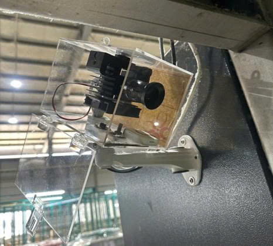
</p>

<table>
  <tr>
    <td align="center">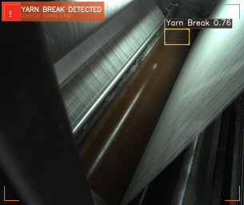<br><sub>Roller camera — conf 0.76</sub></td>
    <td align="center"><br><sub>Roller camera — conf 0.91</sub></td>
  </tr>
  <tr>
    <td align="center"><br><sub>Roller camera — conf 0.91</sub></td>
    <td align="center"><br><sub>Roller camera — conf 0.73</sub></td>
  </tr>
</table>

## Comb cameras

Two more Hikrobot cameras watch the **comb**, where a broken yarn shows up as a fluff ball caught in the comb teeth. Each camera crops the comb strip on the sensor itself (e.g. 4024×1012 out of 12 MP), and both share one YOLO11 detection engine.

<p align="center">
  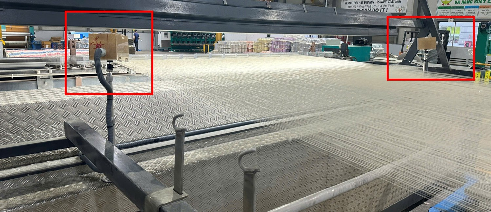
</p>

<p align="center">
  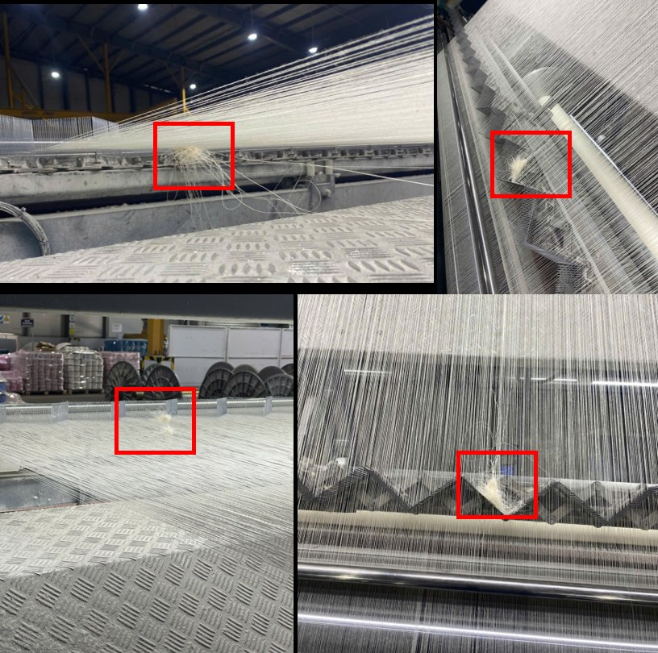<br><sub>What the comb cameras look for</sub>
</p>

Live detections from the comb cameras on the production line. The top row shows real fluff balls being caught while an operator clears the comb; the rest are small clusters picked up early, before they grow.

<table>
  <tr>
    <td align="center">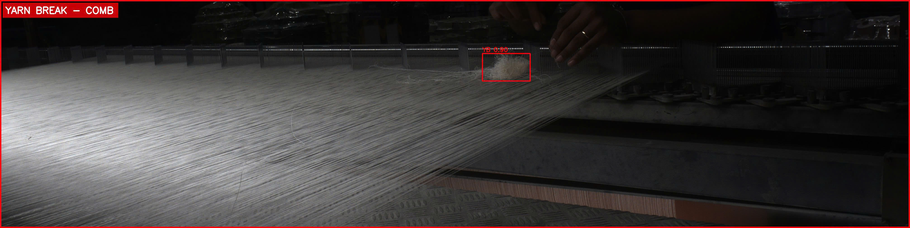<br><sub>Fluff ball at the comb — YB 0.90</sub></td>
    <td align="center">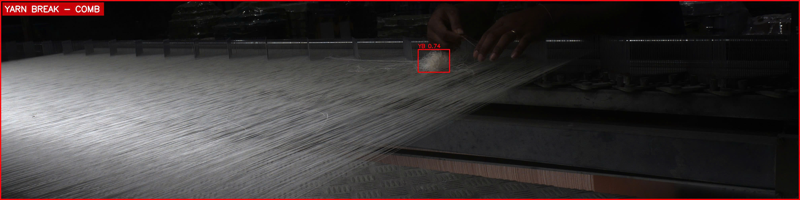<br><sub>Same cluster, operator clearing — YB 0.74</sub></td>
  </tr>
  <tr>
    <td align="center">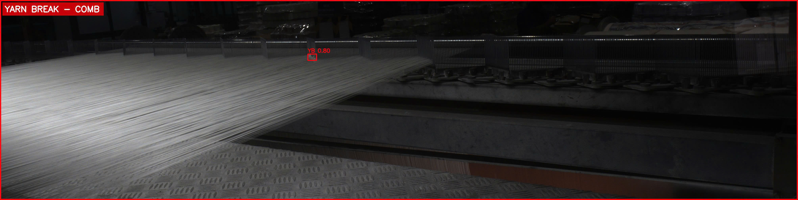<br><sub>Small cluster — YB 0.80</sub></td>
    <td align="center">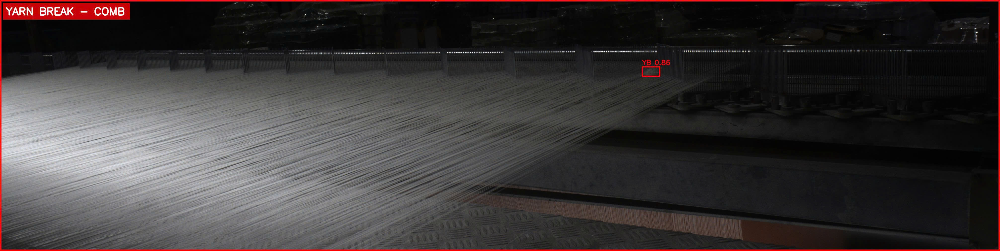<br><sub>Small cluster — YB 0.86</sub></td>
  </tr>
  <tr>
    <td align="center">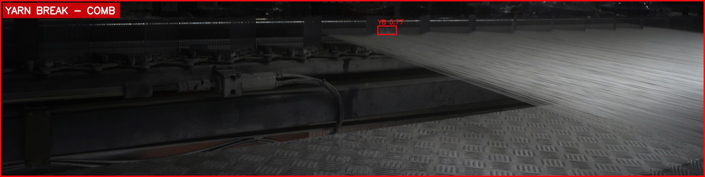<br><sub>Opposite-end camera — YB 0.77</sub></td>
    <td align="center">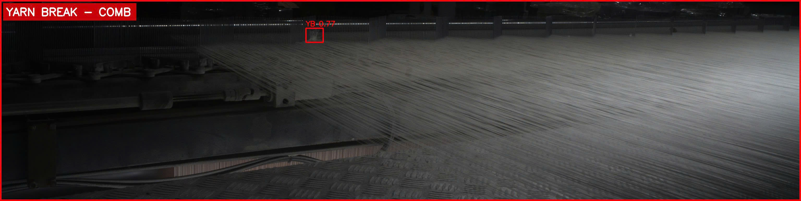<br><sub>Opposite-end camera — YB 0.77</sub></td>
  </tr>
  <tr>
    <td align="center" colspan="2">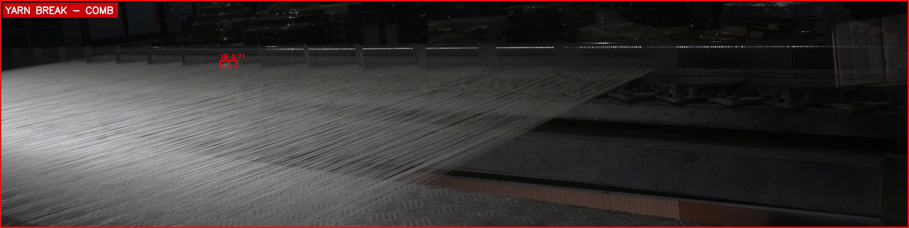<br><sub>Very small cluster caught early — YB 0.71</sub></td>
  </tr>
</table>

Adding or removing a comb camera is a `config.yaml` change only (`comb.cameras[]`, each with `enabled`, `mvs_serial`, `hw_roi`, exposure/gain). Alarm thresholds live in `comb.alert`.

## Model performance

YOLO segmentation model trained on **~2,000 labeled images** collected from the production line.

| Output | Precision | Recall | mAP@50 | mAP@50-95 |
|--------|:---------:|:------:|:------:|:---------:|
| Box    | 0.957 | 0.824 | 0.841 | 0.606 |
| Mask   | 0.945 | 0.813 | 0.824 | 0.350 |

On the Jetson Orin Nano (TensorRT FP16, 960 px input) the live system runs at **~15 FPS with ~58 ms inference per frame** (see the dashboard telemetry below).

High precision keeps false alarms rare, which matters on a factory floor where operators quickly learn to ignore a noisy alarm. Missed frames are covered by the alarm logic: it confirms a break over several consecutive frames instead of relying on a single detection.

## Web control panel

Monitor and control the system from any phone or PC on the factory network: start / stop / pause, live telemetry (FPS, inference time, CPU/GPU temperature), detection history and a user audit log with CSV export. The UI supports Vietnamese, Korean and English.

The upgraded console shows **all three cameras live at once**: the roller camera (*Axis*) and the two comb cameras (*CU120*, *CU060*), each in its own card with status, FPS and inference time and a *Live view* button, next to the system controls and the yarn-break count for the current and previous shift:

<p align="center">
  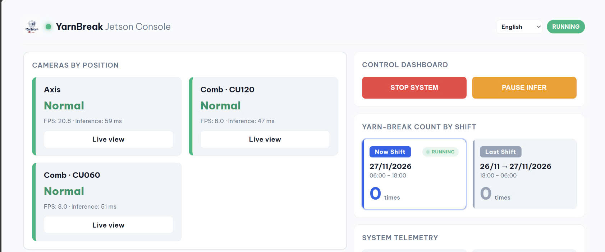
</p>

**Live view / ROI alignment** — the *Live view* button on each camera card opens the live stream with its ROI drawn on top, so a technician can aim the camera until the yarn falls inside the outline:

<table>
  <tr>
    <td align="center" colspan="2">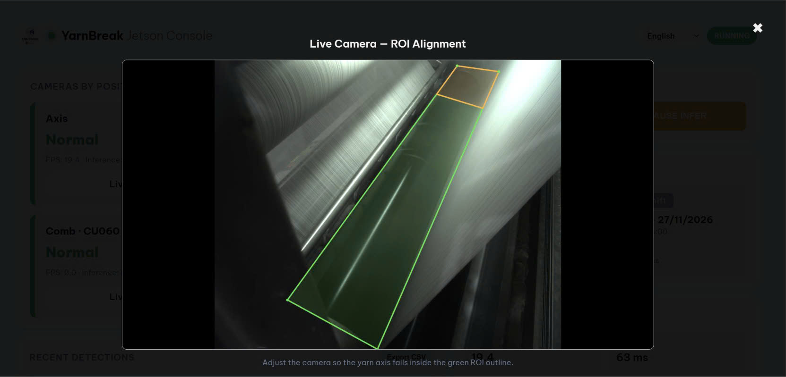<br><sub>Roller camera — green ROI along the yarn axis</sub></td>
  </tr>
  <tr>
    <td align="center">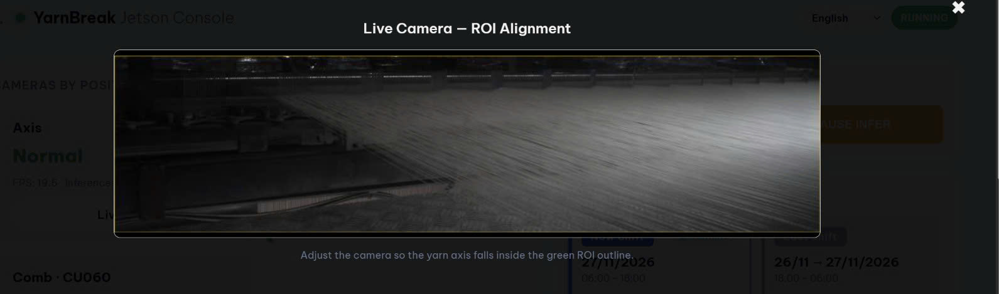<br><sub>Comb camera 1</sub></td>
    <td align="center">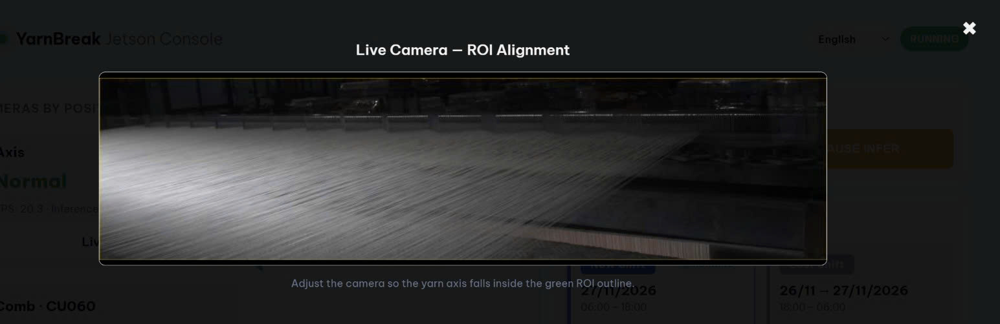<br><sub>Comb camera 2</sub></td>
  </tr>
</table>

## Highlights

- **Multi-camera inference** — one main "roller" camera (segmentation model) plus two "comb" cameras sharing a single TensorRT engine in a round-robin detector thread (TensorRT contexts are not thread-safe, so warm-up and inference stay on one thread).
- **TensorRT FP16** export of YOLO models (`.pt → .onnx → .engine`) for real-time inference on the Jetson GPU.
- **Hardware ROI** on Hikrobot GigE cameras (MVS SDK) — the camera only transmits the region of interest, saving GigE bandwidth and GPU time.
- **Robust alarm logic** — confidence averaging, EMA smoothing, debouncing, rising-confidence confirmation and ROI-based rules to keep false alarms low on a noisy factory floor.
- **Industrial I/O** — `RelayHub` is the single owner of the RS485 port (Waveshare 8DI/8DO, Modbus RTU). Each output channel is the OR of a set of "reasons", so several cameras and states (alarm, paused, watchdog) can drive the same tower light without overwriting each other. Physical red/green push buttons are read from digital inputs.
- **Fault isolation** — a crash in a comb-camera pipeline never stops the main camera; threads restart themselves automatically.
- **Operational safety** — thermal guard (pauses inference above a CPU/GPU temperature limit), camera-loss watchdog, tower-light watchdog, automatic shutdown after prolonged camera loss.
- **Web control panel** (FastAPI + vanilla JS) — login with roles (PBKDF2-hashed passwords, no default credentials), live MJPEG stream, start/stop/pause, alarm history with CSV export, audit log, per-shift break counts, i18n (vi / ko / en). Runs as a Chromium kiosk on the machine's screen.
- **Event recording** — pre-roll ring buffer in RAM, so every alarm gets a short video clip including the seconds *before* the break; snapshots and SQLite alarm log.
- **Deployment** — `systemd` service for auto-start on boot.

## Relay contract

`RelayHub` is the single owner of the RS485 board. Every output channel is the OR of named "reasons", so cameras, buttons, pause and watchdog never overwrite each other. This table is enforced by `tests/test_relay_truth_table.py`:

| State | CH1 red (stop machine) | CH2 (green light off) | CH3 yellow |
|---|:-:|:-:|:-:|
| Running, no fault | 0 | 0 | 0 |
| Roller (beam) camera alarm | 1 | 1 | 0 |
| Comb camera alarm | 1 | 1 | 1 |
| Both alarm | 1 | 1 | 1 |
| Paused (red button / web) | 0 | 1 | 1 |
| Roller camera heartbeat lost | 0 | 0 | 1 |
| Stopped | 0 | 1 | 0 |

CH7 follows CH1: after CH1 has been closed for 7 s it blinks (0.5 s / 0.5 s) until CH1 opens.

## Architecture

```
 Hikrobot GigE cameras (MVS SDK) / RTSP / video file
            │
   FrameGrabber threads (queue maxsize=1 → always newest frame)
            │
   YOLO detector threads (TensorRT FP16)
            │
   Alarm logic (ROI, averaging, debounce)  ──►  RelayHub ──► RS485 Modbus ──► tower lights / buzzer
            │                                       ▲
   StateManager (RUNNING / PAUSED / ALARM)          └── push buttons (DI)
            │
   FastAPI web server ──► MJPEG live view, REST API, SQLite alarm & audit log
```

## Project structure

```
├── main.py               # CLI entry point (thin wrapper around yarnbreak.pipeline)
├── web_server.py         # Web entry point: FastAPI REST API, MJPEG stream (run by systemd)
├── config.yaml           # Single source of truth: cameras, thresholds, relay, ROI…
├── yarnbreak/            # All runtime logic lives in this package
│   ├── pipeline.py       #   Roller-camera main loop wiring the components below
│   ├── config.py         #   AppConfig dataclass, YAML + CLI loader
│   ├── grabbers.py       #   Frame sources: video file, RTSP, Hikrobot MVS camera
│   ├── detector.py       #   YOLO / TensorRT detector thread + smoothing
│   ├── roi.py            #   ROI polygon geometry
│   ├── alerts.py         #   Relay outputs, tower lights, push buttons
│   ├── recording.py      #   Event log, video writer, pre-roll event clips
│   ├── monitoring.py     #   FPS meter, Jetson thermal guard
│   ├── dashboard.py      #   OpenCV dashboard renderer
│   ├── comb_pipeline.py  #   Comb cameras: round-robin TensorRT detector, alarm rules, clips
│   ├── relay_hub.py      #   Single owner of the RS485 board, reason-based outputs
│   ├── modbus_relay.py   #   Modbus RTU driver for Waveshare 8DI/8DO
│   ├── mvs_sdk.py        #   Hikrobot MVS SDK loader + camera lookup by serial
│   ├── inference_worker.py # Runs the pipeline in the background for the web server
│   ├── state_manager.py  #   System state machine (STOPPED / RUNNING / PAUSED / ALARM)
│   ├── alarm_logger.py   #   SQLite alarm + audit log, per-shift counts, CSV export
│   ├── live_view.py      #   Per-camera latest-frame buffers for MJPEG
│   └── auth.py           #   PBKDF2 password hashing + account loading
├── static/, templates/   # Web UI (vanilla JS, i18n vi/ko/en)
├── scripts/              # Operator & maintenance tools (names kept for on-site staff)
│   ├── chay*.sh, open_web_ui.sh       # launchers (web, dashboard, 24/7 headless, kiosk)
│   ├── can_khung_luoc.py              # fit the comb camera's on-sensor ROI
│   ├── kiem_tra_camera.py, mang_comb2.sh  # camera check, static IP + MTU 9000
│   ├── comb_capture.py                # capture raw comb images for labeling
│   └── export_tensorrt.py, benchmark.py, hash_password.py, …
├── tests/                # pytest, hardware-free (fake relay, simulated clock)
├── deploy/               # systemd unit for 24/7 operation
├── docs/                 # operator guide (VI), migration notes, images
└── .github/workflows/    # CI: ruff + pytest + i18n check
```

## Tech stack

Python 3.10 · Ultralytics YOLO · TensorRT · PyTorch · OpenCV · NumPy · FastAPI · Uvicorn · SQLite · Modbus RTU (RS485) · Hikrobot MVS SDK · systemd · JavaScript

Hardware: NVIDIA Jetson Orin Nano 8 GB (JetPack 6), Hikrobot MV-CU120-10GC / MV-CU060-10GC GigE cameras, Waveshare RS485 8DI/8DO relay board.

## Getting started

> Model weights (`*.pt`, `*.engine`) and test videos are **not included** in this repository (size and confidentiality). Place your own model in `models/` and update `config.yaml`.

```bash
python3 -m venv venv && source venv/bin/activate
# On Jetson install PyTorch from the NVIDIA JetPack wheel first (see scripts/install_jetson.sh)
pip install -r requirements.txt
cp .env.example .env
python scripts/hash_password.py   # paste the hash into .env (ADMIN_PASSWORD_HASH=...)

# Run on a video file with the OpenCV dashboard
python3 main.py --source video --video ./videos/sample.mp4 --model ./models/your_model.pt --display

# Run the web control panel (http://localhost:8000)
python3 web_server.py
```

Convert a model to TensorRT on the Jetson (one-time, 5–20 min):

```bash
python3 scripts/export_tensorrt.py --model models/your_model.pt --imgsz 960 --half
```

Install as a 24/7 service:

```bash
sudo cp deploy/yarnbreak.service /etc/systemd/system/
sudo systemctl daemon-reload && sudo systemctl enable --now yarnbreak
journalctl -u yarnbreak -f
```

## Tests

Everything runs on a normal PC — no camera, GPU or relay board — and on every push via GitHub Actions:

```bash
pip install numpy opencv-python-headless PyYAML pytest ruff
ruff check .                   # syntax errors + pyflakes
pytest                         # relay truth table, comb alarm rules, ROI geometry, auth,
                               # event clips, i18n keys, package import check
node tests/check_i18n.js .     # every key used by the HTML/JS has a vi/ko/en translation
```

See [CONTRIBUTING.md](CONTRIBUTING.md) for the quality gate, and [docs/LENH_CHAY.md](docs/LENH_CHAY.md) for the on-site operating guide (Vietnamese).

## License

[MIT](LICENSE)
