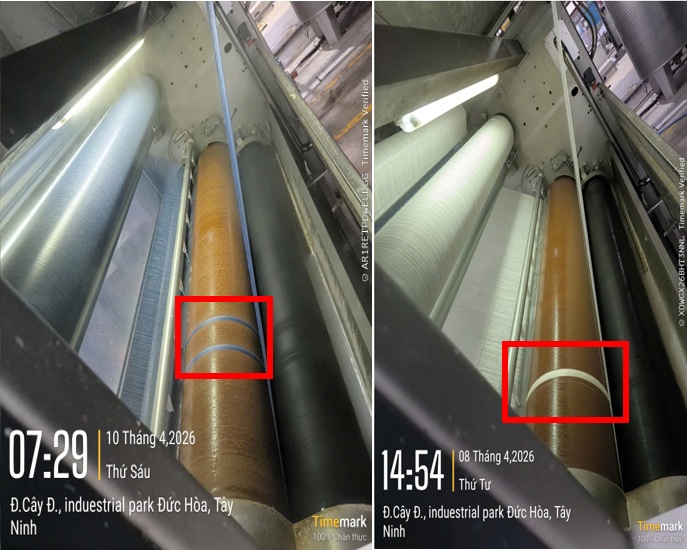
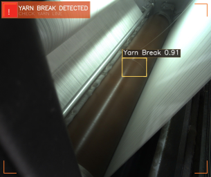
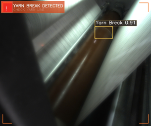
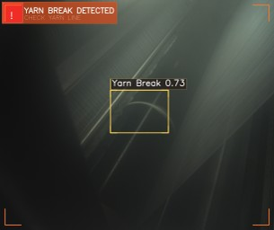
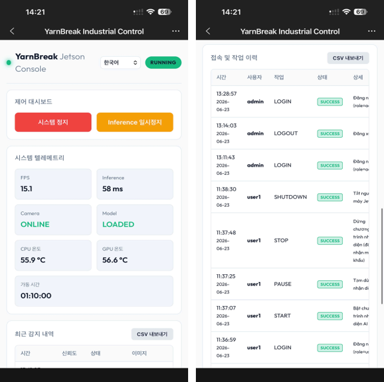

# YarnBreak — Real-time Yarn-Break Detection on NVIDIA Jetson

> **Tóm tắt (VI):** Hệ thống AI phát hiện đứt sợi theo thời gian thực cho máy hồ sợi trong nhà máy dệt, chạy 24/7 trên Jetson Orin Nano. Dùng YOLO (TensorRT FP16) trên nhiều camera công nghiệp Hikrobot GigE, điều khiển đèn tháp/còi qua relay Modbus RS485, có giao diện web giám sát/điều khiển đa ngôn ngữ (Việt / Hàn / Anh).

An edge-AI system that watches yarn on industrial sizing machines and raises an alarm the moment a yarn breaks. It runs unattended **24/7 on a Jetson Orin Nano 8 GB** in a production textile factory.

## The problem

A broken yarn wraps around the rollers of the sizing machine (red boxes). If the operator does not notice it quickly, it damages the product and stops production.

<p align="center">
  
</p>

## Detection results

The model detects the broken yarn in real time, shows the confidence score and triggers the alarm.

<table>
  <tr>
    <td align="center"><br><sub>Roller camera — conf 0.76</sub></td>
    <td align="center"><br><sub>Roller camera — conf 0.91</sub></td>
  </tr>
  <tr>
    <td align="center"><br><sub>Roller camera — conf 0.91</sub></td>
    <td align="center"><br><sub>Roller camera — conf 0.73</sub></td>
  </tr>
</table>

## Model performance

YOLO segmentation model trained on **~2,000 labeled images** collected from the production line.

| Output | Precision | Recall | mAP@50 | mAP@50-95 |
|--------|:---------:|:------:|:------:|:---------:|
| Box    | 0.957 | 0.824 | 0.841 | 0.606 |
| Mask   | 0.945 | 0.813 | 0.824 | 0.350 |

On the Jetson Orin Nano (TensorRT FP16, 960 px input) the live system runs at **~15 FPS with ~58 ms inference per frame** (see the dashboard telemetry below).

High precision keeps false alarms rare, which matters on a factory floor where operators quickly learn to ignore a noisy alarm. Missed frames are covered by the alarm logic: it confirms a break over several consecutive frames instead of relying on a single detection.

## Web control panel

Monitor and control the system from any phone or PC on the factory network: start / stop / pause, live telemetry (FPS, inference time, CPU/GPU temperature), detection history and a user audit log with CSV export. Shown here in Korean (the UI also supports Vietnamese and English).

<p align="center">
  
</p>

## Highlights

- **Multi-camera inference** — one main "roller" camera (segmentation model) plus two "comb" cameras sharing a single TensorRT engine in a round-robin detector thread (TensorRT contexts are not thread-safe, so warm-up and inference stay on one thread).
- **TensorRT FP16** export of YOLO models (`.pt → .onnx → .engine`) for real-time inference on the Jetson GPU.
- **Hardware ROI** on Hikrobot GigE cameras (MVS SDK) — the camera only transmits the region of interest, saving GigE bandwidth and GPU time.
- **Robust alarm logic** — confidence averaging, EMA smoothing, debouncing, rising-confidence confirmation and ROI-based rules to keep false alarms low on a noisy factory floor.
- **Industrial I/O** — `RelayHub` is the single owner of the RS485 port (Waveshare 8DI/8DO, Modbus RTU). Each output channel is the OR of a set of "reasons", so several cameras and states (alarm, paused, watchdog) can drive the same tower light without overwriting each other. Physical red/green push buttons are read from digital inputs.
- **Fault isolation** — a crash in a comb-camera pipeline never stops the main camera; threads restart themselves automatically.
- **Operational safety** — thermal guard (pauses inference above a CPU/GPU temperature limit), camera-loss watchdog, tower-light watchdog, automatic shutdown after prolonged camera loss.
- **Web control panel** (FastAPI + vanilla JS) — login with roles, live MJPEG stream, start/stop/pause, alarm history with CSV export, audit log, per-shift break counts, i18n (vi / ko / en). Runs as a Chromium kiosk on the machine's screen.
- **Event recording** — pre-roll ring buffer in RAM, so every alarm gets a short video clip including the seconds *before* the break; snapshots and SQLite alarm log.
- **Deployment** — `systemd` service for auto-start on boot.

## Architecture

```
 Hikrobot GigE cameras (MVS SDK) / RTSP / video file
            │
   FrameGrabber threads (queue maxsize=1 → always newest frame)
            │
   YOLO detector threads (TensorRT FP16)
            │
   Alarm logic (ROI, averaging, debounce)  ──►  RelayHub ──► RS485 Modbus ──► tower lights / buzzer
            │                                       ▲
   StateManager (RUNNING / PAUSED / ALARM)          └── push buttons (DI)
            │
   FastAPI web server ──► MJPEG live view, REST API, SQLite alarm & audit log
```

## Project structure

```
├── main.py              # Main detection application (grabber → detector → alarm → dashboard)
├── comb_pipeline.py     # Multi-camera "comb" pipeline (round-robin TensorRT detector)
├── web_server.py        # FastAPI server: auth, REST API, MJPEG stream
├── inference_worker.py  # Runs the detector in the background for the web server
├── state_manager.py     # System state machine (STOPPED / RUNNING / PAUSED / ALARM)
├── alarm_logger.py      # SQLite alarm + audit log, CSV export
├── live_view.py         # Shared latest-frame buffer for MJPEG streaming
├── relay_hub.py         # Single owner of the RS485 relay board, reason-based outputs
├── modbus_relay.py      # Modbus RTU driver for Waveshare 8DI/8DO
├── mvs_sdk.py           # Hikrobot MVS SDK loader + camera lookup by serial
├── config.yaml          # All site configuration (cameras, thresholds, relay, ROI…)
├── static/, templates/  # Web UI (vanilla JS, i18n vi/ko/en)
├── scripts/             # TensorRT export, benchmark, Jetson install guide
├── tests/               # Hardware-free tests (fake clock / fake relay, i18n check)
├── docs/images/         # Screenshots used in this README
└── yarnbreak.service    # systemd unit for 24/7 operation
```

## Tech stack

Python 3.10 · Ultralytics YOLO · TensorRT · PyTorch · OpenCV · NumPy · FastAPI · Uvicorn · SQLite · Modbus RTU (RS485) · Hikrobot MVS SDK · systemd · JavaScript

Hardware: NVIDIA Jetson Orin Nano 8 GB (JetPack 6), Hikrobot MV-CU120-10GC / MV-CU060-10GC GigE cameras, Waveshare RS485 8DI/8DO relay board.

## Getting started

> Model weights (`*.pt`, `*.engine`) and test videos are **not included** in this repository (size and confidentiality). Place your own model in `models/` and update `config.yaml`.

```bash
python3 -m venv venv && source venv/bin/activate
# On Jetson install PyTorch from the NVIDIA JetPack wheel first (see scripts/install_jetson.sh)
pip install -r requirements.txt
cp .env.example .env            # set web login passwords

# Run on a video file with the OpenCV dashboard
python3 main.py --source video --video ./videos/sample.mp4 --model ./models/your_model.pt --display

# Run the web control panel (http://localhost:8000)
python3 web_server.py
```

Convert a model to TensorRT on the Jetson (one-time, 5–20 min):

```bash
python3 scripts/export_tensorrt.py --model models/your_model.pt --imgsz 960 --half
```

Install as a 24/7 service:

```bash
sudo cp yarnbreak.service /etc/systemd/system/
sudo systemctl daemon-reload && sudo systemctl enable --now yarnbreak
journalctl -u yarnbreak -f
```

## Tests

These run on any PC — no camera, GPU or relay board required:

```bash
python tests/test_comb_clip.py        # event-clip timing rules with a fake clock
python tests/test_pause_yellow.py     # relay reason logic with a fake relay board
node   tests/check_i18n.js .          # all 3 languages have the same translation keys
```
